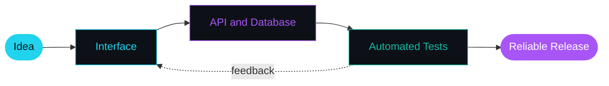
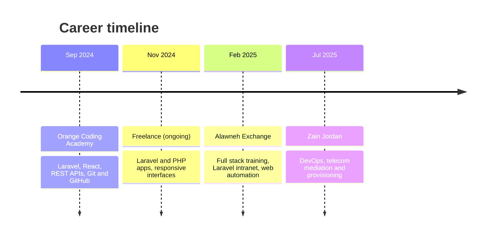

<div align="center">


<a href="https://github.com/ahmad-alfararjeh">

</a>

<br/>


<br/><br/>


<br/><br/>

[](https://www.linkedin.com/in/ahmad-alfararjeh)
[](mailto:ahmad.a.alfararjeh@gmail.com)
[](https://github.com/ahmad-alfararjeh?tab=repositories)

</div>


<h2>&nbsp; About me</h2>

<table>
<tr>
<td width="62%" valign="top">

I'm a **full stack developer from Jordan** who enjoys connecting responsive interfaces, REST APIs, and databases into complete products, using **Laravel, PHP, JavaScript, and React**.

At **Alawneh Exchange** I was introduced to web test automation with **Selenium WebDriver, Katalon Studio, and Ranorex**. Now I'm growing my QA skills and studying for **ISTQB CTFL**.

 **BSc in Computing Smart Devices**, Tafila Technical University, graduated with distinction (**2nd in class**).

</td>
<td width="38%" valign="top">

```yaml
status:   building & learning
focus:    Laravel, QA, web testing
studying: ISTQB CTFL
open_to:
  - QA internships
  - Full stack roles
  - Collaborations
```

</td>
</tr>
</table>

<h3>&nbsp; How I work</h3>




<h2>&nbsp; Tech universe</h2>

<div align="center">


**Web**<br/>


**Other languages**<br/>


**Data and tools**<br/>


**Quality assurance**<br/>

<br/>


</div>

<br/>

<table>
<tr>
<th align="left" width="28%">Area</th>
<th align="left">Skills and technologies</th>
</tr>
<tr>
<td>&nbsp; <b>Backend and APIs</b></td>
<td>PHP, Laravel, REST APIs, end-to-end web features</td>
</tr>
<tr>
<td>&nbsp; <b>Frontend</b></td>
<td>JavaScript, React, HTML, CSS, Bootstrap, responsive interfaces</td>
</tr>
<tr>
<td>&nbsp; <b>Databases</b></td>
<td>MySQL, PostgreSQL, Firebase</td>
</tr>
<tr>
<td>&nbsp; <b>QA and automation</b></td>
<td>Selenium WebDriver, Katalon Studio, Ranorex, test execution and validation</td>
</tr>
<tr>
<td>&nbsp; <b>Tools</b></td>
<td>Git, GitHub, Visual Studio Code, Android Studio</td>
</tr>
<tr>
<td>&nbsp; <b>Workflow</b></td>
<td>Figma, Trello, Agile, Scrum, SDLC</td>
</tr>
</table>


<h2>&nbsp; My journey</h2>



<table>
<tr>
<th align="left" width="38%">Experience</th>
<th align="left">Focus</th>
</tr>
<tr>
<td><b>Zain Jordan</b><br/><sub>Jul 2025 – Jun 2026</sub></td>
<td>DevOps, telecom mediation and provisioning; workflow automation and system integration support</td>
</tr>
<tr>
<td><b>Alawneh Exchange</b><br/><sub>Feb – May 2025</sub></td>
<td>Full stack development training; Laravel intranet and practical web automation exposure</td>
</tr>
<tr>
<td><b>Freelance</b><br/><sub>Nov 2024 – Present</sub></td>
<td>Laravel and PHP applications, responsive interfaces, and complete features</td>
</tr>
<tr>
<td><b>Orange Coding Academy</b><br/><sub>Sep 2024 – Jan 2025</sub></td>
<td>Laravel, React, REST APIs, and collaboration through Git/GitHub</td>
</tr>
</table>

<h2>&nbsp; Things I've built</h2>

<table>
<tr>
<td width="50%" valign="top">

<h3>&nbsp; Alawneh Intranet</h3>

Laravel-based enterprise intranet and content management.


</td>
<td width="50%" valign="top">

<h3>&nbsp; Orange LMS</h3>

Learning management workflows: cohorts, submissions, attendance, and reporting.


</td>
</tr>
<tr>
<td width="50%" valign="top">

<h3>&nbsp; ProvGate</h3>

Telecom provisioning simulation, subscriber comparison, and HLR profile validation.


</td>
<td width="50%" valign="top">

<h3>&nbsp; Vehicle Loss Reporting and Tracking</h3>

Mobile reporting, a web management portal, and Firebase integration.


</td>
</tr>
<tr>
<td width="50%" valign="top">

<h3>&nbsp; <a href="https://github.com/ahmad-alfararjeh/Genius-app">Genius App</a></h3>

Java utilities for everyday calculations and conversions.


</td>
<td width="50%" valign="top">

<h3>&nbsp; <a href="https://github.com/ahmad-alfararjeh/Protfolio_Ahmad_Alfararjeh.github.io">Portfolio</a></h3>

My personal web portfolio project.


</td>
</tr>
</table>

<div align="center">

[**Browse all my repositories →**](https://github.com/ahmad-alfararjeh?tab=repositories)

</div>


<h2>◈ Code in motion</h2>

<div align="center">

</div>

### Contribution pulse

<p align="center">

</p>

### The bigger picture

<p align="center">

</p>

### Language landscape

<p align="center">


</p>

<p align="center"><sub>Charts reflect public GitHub activity and repository data; language usage is not a proficiency rating.</sub></p>


<h2>◈ Currently</h2>

- Building **Laravel** applications with clean, tested code
- Studying for **ISTQB CTFL** and practicing repeatable web testing
- Looking for **QA internships** and **full stack** opportunities

<div align="center">


### Let's build something useful

[](https://www.linkedin.com/in/ahmad-alfararjeh)
[](mailto:ahmad.a.alfararjeh@gmail.com)
[](https://github.com/ahmad-alfararjeh)

</div>


